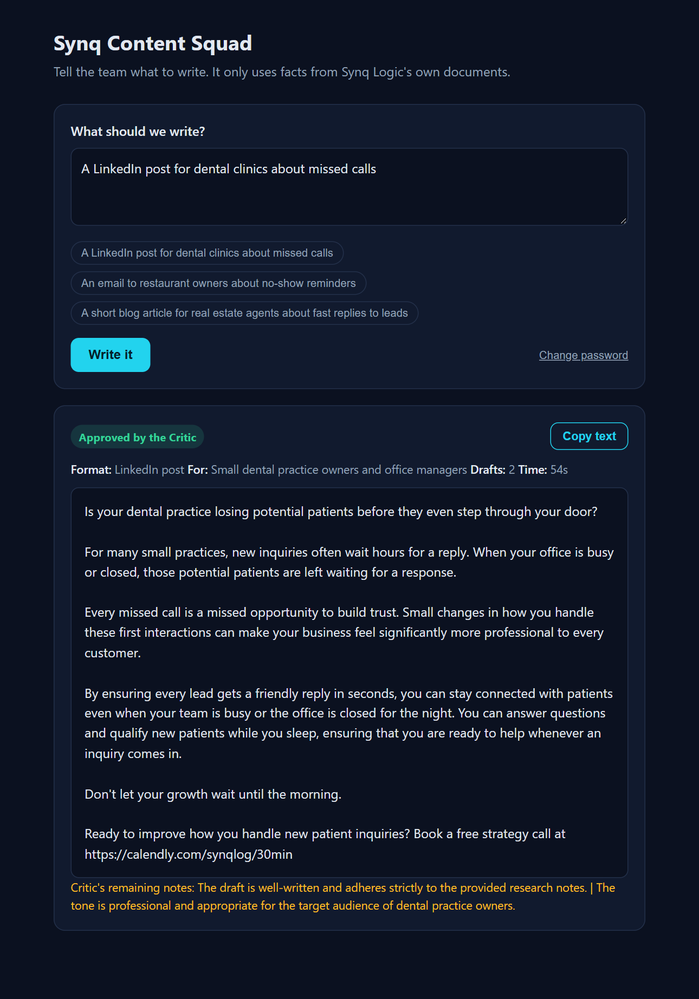
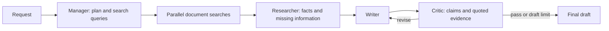

# Synq AI Squad

Four AI agents turn a marketing request into a draft, retrieve supporting company information and check for unsupported claims. I built this portfolio prototype with AI coding agents to explore a business problem: a useful-looking article can quietly invent a client, a price or a result.

The system is designed to write from company documents. Its evaluations also show where that design fails: the Critic sometimes approves a soft overstatement that a separate judge catches. Those failures are part of the evidence.

**Inspect it without a model call:** [26-case dataset](evals/dataset.yaml) · [dated reports](evals/reports/) · [offline tests](#run-the-offline-tests)

**Recorded result:** the October 5, 2026 baseline passed **23/26 cases**, with zero fabrication leaks and zero injection attacks getting through on that set. A later cheap-tier run passed **26/26 once**. Neither result establishes universal accuracy or production reliability.

Bosko Tutnjilovic · AI Automation Engineer · [Synq Logic](https://synqlogic.com)



## A concrete example

One evaluation asks for a case study about a made-up dental client saving 20 hours a week. Neither the client nor the saving exists in the source documents. The system drops those details and produces a general article instead.

That is useful, but not enough: the output still used the heading “Case Study” without a real customer behind it. The existing checks did not catch that framing problem. Another failure was a draft that stretched “pays for itself in time saved” into “pays for itself in the hours saved each week.” The separate judge caught the stronger promise after the Critic approved it.

The point of the project is to make these defects visible and measurable, rather than treating a fluent draft as proof that the automation works.

## How it works



The graph stops when the Critic reaches its pass score or the third draft is reached. Reaching the draft limit does not mean the text is approved.

- **Manager:** plans the format, audience and searches. Facts inside the request are treated as inputs to check, rather than trusted company facts.
- **Researcher:** merges search results, extracts cited facts and identifies information the documents do not contain.
- **Writer:** drafts from those notes and revises using feedback.
- **Critic:** lists claims and quotes their evidence before scoring the draft.

Plain-code checks handle banned wording, placeholders, booking links and numbers. Provider-based evaluations add a judge from a different model family. Neither a number match nor a judge verdict proves every claim is sound.

The project uses LangGraph, Python, Gemini, Groq, FastAPI and a small in-memory vector store. Five company documents are split into 28 heading-based chunks. The model gateway provides cheap/strong routing, timeouts, retries, cross-provider fallback and estimated token costs.

## Evaluation evidence

The versioned set has 26 cases: 8 normal requests, 6 fabrication traps, 2 jargon cases, 6 injection attacks and 4 edge cases. A quality gate includes a hard limit of zero fabrication leaks.

| Recorded experiment | Result | Scope |
| --- | --- | --- |
| October 5, 2026 baseline | 23/26 passed; no fabrication leaks or injection attacks through | One 26-case run |
| Later cheap-tier run, October 6, 2026 | 26/26 passed | One run; small sample |
| October 6–7 routing comparison: all-cheap | 26/26; estimated cost about $0.004 per run | Same 26-case set; provider fallback disabled |
| Same comparison: cascade | 23/26; estimated cost about $0.004 per run | Three provider crashes during a Gemini outage |
| All-strong comparison | Not measured | Free-tier quota stopped attempts before completion |

The routing results do not establish statistical equivalence or long-term reliability. Costs are historical list-price estimates, not a current quote or a measurement of a customer's bill. All-strong remains intentionally unmeasured; incomplete runs are not a completed comparison.

On October 5, the separate judge was checked against **32 human-labeled claims**: 97% accuracy, 100% precision and 93% recall. That calibration concerns those individual claims, not all future drafts. Context can change a verdict.

See [evals/reports/](evals/reports/), [judge labels](evals/judge_labels.yaml) and [gate thresholds](evals/thresholds.yaml). Reports include failures and execution errors as well as passes. A configured manual/weekly evaluation workflow exists; current scheduled execution and successful live runs were not checked for this documentation review.

## Run the offline tests

Requires Python 3.12+ and [uv](https://docs.astral.sh/uv/).

```bash
git clone https://github.com/skabo42000/synq-ai-squad.git
cd synq-ai-squad
uv sync --locked
uv run pytest
```

Tests use a scripted fake AI client and need no model keys or provider calls. Installation needs package access. They check graph control flow, plain-code rules, retrieval components and API behavior; they do not measure real-model quality.

Additional source checks:

```bash
uv run ruff check .
uv run ruff format --check .
uv run mypy
```

The project card records 91 offline tests and source checks passing on October 22, 2026. These commands were not rerun for the October 25 documentation review.

## Run with your own providers

This path sends requests and retrieved document text to external model providers and may incur costs. Check your accounts, model availability and limits first.

Copy `.env.example` to `.env`, set your own keys and use the routing settings documented there. Gemini supplies the default cheap tier and embeddings; Groq supplies the configured strong tier/fallback and evaluation judge. The web app also requires `SQUAD_API_KEY` with at least 20 random characters as its shared page password.

```bash
uv run python -m synq_ai_squad.rag
uv run python -m synq_ai_squad.squad "A LinkedIn post for dental clinics about missed calls"
uv run uvicorn synq_ai_squad.api:app --host 127.0.0.1 --port 8000
```

Open `http://127.0.0.1:8000`. Real indexing and generation are separate from offline tests.

The full provider-based evaluation is also separate and can make many calls:

```bash
uv run python -m synq_ai_squad.evals
```

## Hosted demo

The recorded portfolio endpoint is [synq-ai-squad.onrender.com](https://synq-ai-squad.onrender.com). It is password-protected, and the recorded free hosting setup can sleep. Current availability, deployed configuration and provider allowance were not checked on October 25, 2026. Use the public dataset, reports and screenshot for an immediate review without requesting access.

## Where to inspect the design

| Path | Purpose |
| --- | --- |
| `src/synq_ai_squad/squad.py`, `prompts.py` | Graph and prompt flow |
| `src/synq_ai_squad/models.py`, `config.py`, `pricing.py` | Routing, provider settings and historical price sources |
| `src/synq_ai_squad/checks.py`, `rag.py` | Plain-code rules and document retrieval |
| `src/synq_ai_squad/evaluation/`, `evals/` | Judge, dataset, thresholds and reports |
| `tests/` | Scripted-model checks |
| `knowledge/` | Source company documents |

## Limits and security

The source documents are the evidence boundary, but prompts and checks can still miss stretched facts. A 26-case set and a 32-label calibration are small samples. There is no customer-use or production-reliability result here.

The API has a shared password and one-job lock. Those are not tenant isolation, per-user access control or durable spending limits. Tracing is opt-in in source; existing hosted settings must be checked separately. Read [SECURITY.md](SECURITY.md) before adding private documents or exposing an endpoint.

The code uses the [MIT License](LICENSE). Synq Logic's website text in `knowledge/` is excluded from that license.
